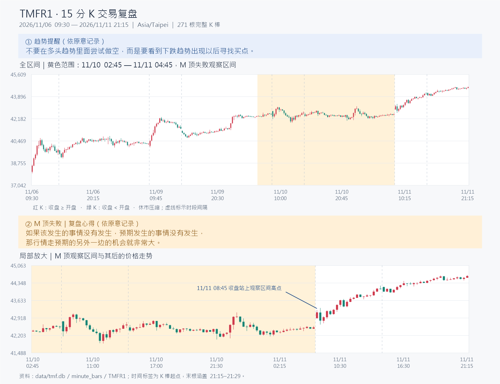

# TMFR1 15 分 K 复盘｜2026/11/06–11/11

- 商品：TMFR1（专案讯号商品）。
- 图表区间：2026/11/06 09:30 至 2026/11/11 21:15，台北时间（Asia/Taipei）。
- 周期：15 分 K；红涨绿跌。横轴压缩休市时间，虚线表示交易时段间隔。

[打开可缩放互动图](assets/2026-11-06_11-11_15m/chart.html) · [向量图](assets/2026-11-06_11-11_15m/chart.svg) · [15 分 K 资料](assets/2026-11-06_11-11_15m/bars.csv)

## 1. 趋势提醒

> 不要在多头趋势里面尝试做空，而是要看到下跌趋势出现以后寻找买点。

以上依原意记录。

## 2. M 顶失败

观察区间：**2026/11/10 清晨 02:45 至 2026/11/11 清晨 04:45**。依本次复盘标记，这段出现 M 顶，但这个 M 顶失败；图中的黄色范围标示这段区间。

> 如果该发生的事情没有发生，预期发生的事情没有发生，那行情走预期的另外一边的机会就非常大。

局部图一并保留区间后的走势供对照：区间内最高价为 **43,145**；其后 **11/11 08:45** 这根 15 分 K 收在 **43,149**，高于该区间最高价。

## 3. 多頭趨勢中，盡量避免跌破小多頭趨勢線就做空

在整體多頭趨勢裡，沿著其中一段小多頭走勢，可以畫出直線或曲線的趨勢線。即使這條線與各個低點仍有一段距離，它所在的位置也很可能就是短線小空頭的反轉點，行情可能在這附近結束回落、重新向上。

因此，看到價格向下突破這條小多頭趨勢線就進空單，常常會遇到行情直接往上拉，空單隨即被打停損。這種跌破未必代表整體多頭趨勢已經反轉。

> 在多頭趨勢裡，僅因一段小多頭的直線或曲線趨勢線被向下突破，就進場做空，這件事情盡量不要做。

## 资料说明

使用本机统一资料库 `data/tmf.db` 的 `minute_bars`（`code=TMFR1`），沿用专案 `session_bars.minute_bars_to_interval(..., 15)` 的交易时段聚合方式。共读取 **4,065 根 1 分 K**，组成 **271 根 15 分 K**，每根均有 15 笔分钟资料；未补造缺失价格。

图中时间均为 **K 棒起始时间**；最后标记为 11/11 21:15 的 K 棒使用 **21:15–21:29** 分钟资料，于 21:30 收定。此处按「包含 21:15 这根 15 分 K」制作。年份按本次复盘日期采用 **2026 年**。
