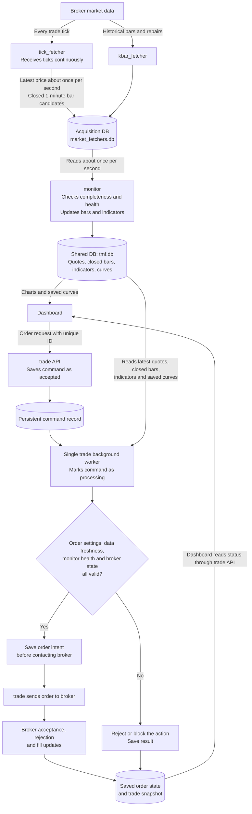

# Market data and order workflow

Reviewed: November 7, 2026. This describes the simulation/production workflow. Mock mode uses a separate offline engine.

## Is the slow-processing issue solved?

The performance improvements are implemented, but reliable operation has not yet been fully verified.

- Curve entry checks process previously unchecked minutes rather than checking every historical minute again.
- The latest contract closing price is fetched directly instead of loading its entire history for that lookup.
- Monitor caches historical data and writes only changed bars, while still handling broker corrections and invalidated tick bars.

Some curve calculations still load historical data. The weekly report also lists unresolved problems where old trade snapshots can appear fresh, or a failed background operation can delay queued commands. Fresh ticks alone do not prove that trade is keeping up. Windows long-running operation and broker verification remain pending.

## Workflow chart

The timing labels describe configured/default intervals, not guaranteed end-to-end latency. The trade worker waits 0.5 seconds between completed cycles; slow work can extend the actual cycle time. Tick bar publication also waits for the configured close delay (currently 2 seconds).

## Simple explanation

- **Market updates:** Tick fetcher receives ticks continuously and publishes the latest changed prices about once per second. It also builds completed 1-minute bar candidates. Kbar fetcher supplies broker history and repairs.
- **Shared data:** Monitor reads the acquisition DB and publishes usable bars, quotes, indicators and health information to the shared DB. Broker bars take priority. Known incomplete minutes are left for repair and excluded from strategy bars; curve decisions cannot cross missing minutes.
- **Order requests:** Dashboard sends an order through TradeClient to the local trade API with a persistent unique ID. Dashboard does not place broker orders itself. Trade saves the command before its single background worker executes it.
- **Execution:** Trade reads the shared DB for current market data and safety checks, saves its order intent, then sends a valid order through its own broker connection. Trade does not subscribe to ticks or fetch a separate set of strategy market data.
- **Manual orders:** A valid manual order can proceed after the required checks. It does not need to wait for another curve signal.
- **Automatic decisions:** Curve entry uses two adjacent, completed 1-minute bars and preserves the curve's source timeframe. Fresh signal quotes must still be on the breakout side. A tick touching the curve does not trigger entry. Fixed stop-loss, take-profit and breakeven decisions use completed 1-minute bars of the actual month contract; curves use TMFR1.
- **Results:** A command marked `succeeded` means the command finished handling the request, not that the broker accepted or filled the order. Broker updates determine the order's later state. A timeout is handled by checking the original command ID; an unknown outcome requires verification before another order is submitted.
- **Freshness:** Tick reception, monitor synchronization and trade snapshot updates are separate stages. Each can become delayed independently.

## References

- [Weekly issues summary](../plan/2026-11-07-weekly-issues-summary.md)
- [Independent trade service](independent_trade.md)
- [Market fetchers and monitor](independent_market_fetchers.md)
- [Trade API and background worker](../src/trade.py)
- [Independent trading adapter](../src/trade_service.py)
- [Monitor](../src/monitor.py)
- [Tick fetcher](../src/tick_fetcher.py)

This document records the source-code workflow and the reported verification limits. It does not confirm deployment, live broker behavior or current session usage.
