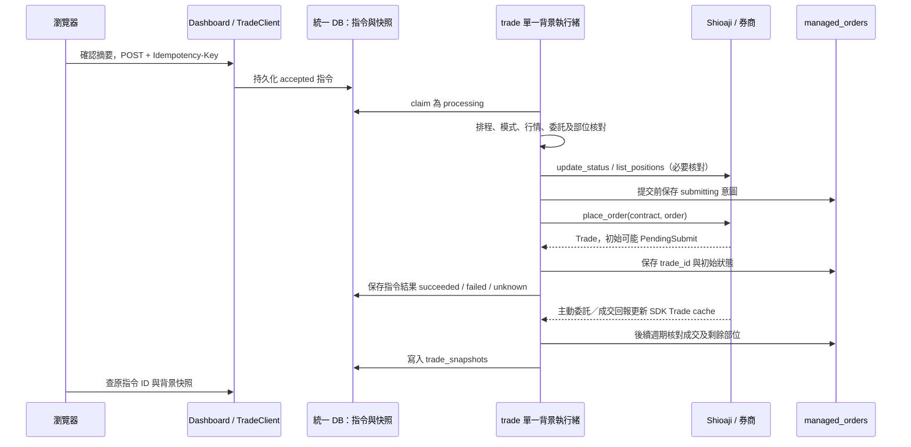

# 現行期貨下單流程與官方文件核對

檢查日期：2026-11-12（Asia/Taipei）。本機環境：conda `tss`，Shioaji **1.7.7**。
本文件已於同日重新核對；本輪時間、測試結果及檔案 SHA-256 以 [審查紀錄](futures_order_review_2026-11-12.json) 為準。
本文件記錄檢查時工作目錄的實作，含既有、尚未提交的部位核對修改；不是單純的 Git HEAD，也不代表目前執行中的服務已載入這份程式。
基準 HEAD：`ac1a8401cdf53e23cfdeb6075d6a63c1f17abec3`。檔案雜湊與驗證結果另存於同目錄的審查紀錄。

結論：**核心期貨送單欄位、`place_order(contract, order)`、正式環境 CA、撤單使用原 Trade，以及 PendingSubmit 後續核對的方向符合官方文件。**
仍使用相容介面的 `sj.Order`／`api.Contracts`，與官方主要範例的 `sj.FuturesOrder`／`api.contracts.get` 不完全相同。
另外，`Auto` 的開平倉語意、同步核對造成的延遲，以及本機風控與券商委託的差別，需要分開理解；不能以「API 參數合法」推論策略語意或實際券商驗收均已完成。

本次為原始碼審查與離線驗證，未登入券商、送出／修改／撤銷實單、重啟或部署服務，也未修改交易實作。

## 核對依據與範圍

- [使用者指定的官方 Futures and Option 文件](https://sinotrade.github.io/tutor/order/FutureOption/)：登入／CA、期貨委託參數、PendingSubmit、改價／減量與撤單。
- [官方委託／成交回報欄位](https://sinotrade.github.io/tutor/order/OrderEvent/)：委託與成交資料的區分。
- 專案 Shioaji skill 的 [ORDERS.md](../.agents/skills/shioaji/references/ORDERS.md)、[CONCEPTS.md](../.agents/skills/shioaji/references/CONCEPTS.md)、[MIGRATION.md](../.agents/skills/shioaji/references/MIGRATION.md)。
- 本機 SDK 的函式 signature、`Order`／`FuturesOrder` 建構檢查及現有離線測試。

主要路徑是正式／模擬模式的獨立 `trade.py`。Mock 模式另由 Dashboard 的離線引擎處理。
目前 `config/runtime.json` 的訊號商品是 `TMFR1`、實際月份商品包含 `TMFK6`；這是**微台**配置。
`quote_probe.py` 的小台 `MXFR1` 訂閱測試不會改變主系統下單商品。現行合約列舉／解析走 `Contracts.Futures`，本報告不宣稱已支援選擇權下單 UI 或選擇權商品解析。

## 與官方文件的對照

| 項目 | 現行實作 | 核對結果 |
|---|---|---|
| 下單前登入、正式 CA | `sc.connect()` 登入；獨立 trade 在 production 呼叫 `activate_ca()`，回傳 False 即失敗 | 符合設計；本次未做實際 CA 驗證 |
| 合約與委託分別傳入 | `api.place_order(contract, order, timeout=...)` | 符合 |
| 委託建構 | `sj.Order(...)`，具備 action、price、quantity、price_type、order_type、octype、account | 必要欄位符合；採相容介面。1.7.7 可建立現行物件，未以實送確認所有型別轉接行為 |
| 官方主要建構範例 | `sj.FuturesOrder(...)` | 後續可獨立遷移為明確期貨型別，避免與股票型別混淆 |
| 合約查找 | 舊版 `api.Contracts.Futures`、依商品 root 列舉並比對月份 | 有相容介面差異；不是已證實的送單故障 |
| 價格與效期 | 接受 LMT／MKT／MKP、ROD／IOC／FOK；本地拒絕 MKT／MKP + ROD | 本地有額外組合驗證；市價送出的 price 正規化為 0 |
| 開平倉欄位 | 一般送單固定 `Auto`；自動出場固定 `Cover` | 都是文件列出的合法值；Auto 不保證產生新倉 |
| PendingSubmit | 保存初始狀態，後續讀 Trade cache／必要時 update_status，再更新本地 DB | 符合「初次回傳不代表完成」的方向 |
| 撤單 | 取得原 Trade，`api.cancel_order(trade)`，繼續核對是否完成及是否已有成交 | 符合；取消請求不等於成交部位消失 |
| 券商改價／減量 | 正式應用路徑沒有呼叫 `api.update_order()` | 尚未提供文件中的券商掛單改價／減量功能 |
| 停損／停利調整 | 更新本地 managed_orders，策略成立時另送出 Cover 委託 | 這是本機策略設定，不是券商掛單改價或已預掛的停損單 |

本機 1.7.7 的 `FuturesOrder` signature 仍使用 `order_type`，本次不將 skill 中針對較新版本的 `time_in_force` 名稱套進舊環境。

## 手動送單的現行控制流



1. 瀏覽器先確認商品月份、買賣、口數、價格類別／效期及風控摘要。建立唯一 ID，暫存在 `sessionStorage`，透過 Dashboard `/api/trading/orders` 傳入 `Idempotency-Key`。
2. Dashboard 正式／模擬模式使用 `TradeClient`，先比對 trade 快照的 DB、商品與模式，再 POST `/api/commands`。HTTP handler 驗證及保存指令，不登入、不下單。
3. `trade_commands` 相同 ID／相同內容讀原結果；相同 ID／不同內容回 409。背景執行緒每輪最多 claim 一筆 accepted，先 commit processing 才執行。
4. `IndependentTradingService.place_order()` 檢查 unknown 指令、登入窗口、月份合約的新鮮報價與 monitor 收定 1 分 K。報價時效取設定中的 10 秒；K 棒時效取 `bar_lag_seconds`，目前 180 秒。
5. 共用 `TradingService.place_order()` 驗證 confirmed、模式、買賣、1–100 整數口數、有限價格及合法組合；拒絕既有結果不明的委託。送單前以 `force=True` 同步委託，並完成券商部位核對；有未管理的未結束委託、未確認的 Trade 身分或部位差異時阻擋新倉。已確認終止、零成交的失敗出場委託有保留歷史紀錄的例外處理，不因重新登入後缺少該筆 Trade 就抹除既有證據。
6. 檢查實際月份在可用合約清單、1h ATR、選用畫線存在且啟用；限價依合約 tick 對齊。初始固定風控以 2 × ATR 建立，成交後再依成交均價更新；選畫線停利時不設固定 target。
7. 先在 `managed_orders` 保存唯一 row ID、`entry_status='submitting'`、`entry_trade_id='unresolved:<row ID>'` 及風控設定，commit 後才呼叫券商。此處的本地 row ID 與券商 trade ID 是兩種 ID。
8. `ShioajiOrderAdapter` 建構下面的委託，透過 `OrderSession` 在真正送出前再次檢查窗口、停止要求、恢復狀態及 broker_ready：

   ```python
   order = sj.Order(
       action=getattr(sj.Action, request.action),
       price=normalized_price,
       quantity=request.quantity,
       price_type=getattr(sj.FuturesPriceType, request.price_type),
       order_type=getattr(sj.OrderType, request.order_type),
       octype=sj.FuturesOCType.Auto,
       account=api.futopt_account,
   )
   trade = api.place_order(contract, order, timeout=30000)
   ```

   這是目前程式的欄位映射摘要；timeout 實際取 `HealthSettings.api_timeout_ms`，目前 30000 ms。測試注入 API 的路徑省略 timeout 參數。

9. 取得 `trade.order.id` 或 `trade.status.id` 後保存初始狀態。沒有 ID、呼叫拋錯或送出後持久化失敗時，保留未知 claim、關閉 broker_ready，不在這裡重新送單。
10. 指令 `succeeded` 代表這次服務方法正常返回，**不是券商已成交**。Adapter 不把帶 ID 的 `Failed` 自動轉成例外；UI／呼叫端仍須讀 `entry_status`。後續週期會處理 Failed／Cancelled 零成交停用、部分成交及全成交。

## 成交、部位與快照

- trade 登入使用 `api.login()` 預設的交易回報訂閱。獨立 trade 的 order callback 只更新事件時間；不在 callback 查帳、送單或寫完整交易狀態。
- 本機 1.7.7 已具主動回報更新 Trade cache 的介面；背景週期讀 `list_trades()`，把 `deal_quantity`／`deals`、狀態與均價持久化至 managed_orders／PnL。
- `IndependentTradingService._trades_by_id()` 一般以 `order_sync_seconds=60` 節流 `update_status()`；其間讀 SDK cache。送單前與自動平倉前的 `force=True` 仍會強制 RPC。
- 需要部位核對時呼叫 `list_positions(api.futopt_account)`，對照本機剩餘持倉；不能用「券商淨部位為零」單獨推論某筆本地單已平倉。
- `broker_octype` 記錄券商實際開平倉類別；確認為 Cover 的反向委託停用自身 auto_exit，也不通知為新開倉。完整歸帳條件及成交保存流程見下節。
- 進場與出場同步均使用 `confirmed_price_only=True` 讀取成交均價；重新登入若只回傳摘要，不以觸發價、委託價或 modified_price 取代先前已確認均價。進出場累計成交增加且持久化後才交給 Telegram 通知，沿用既有去重設定。
- Dashboard 查詢 `/api/snapshot` 讀背景保存的 trade_snapshots，不觸發券商同步。背景每輪在策略檢查、可能的 margin 查詢及指令執行後才保存快照。檢查期間更新的版本會同時檢查 heartbeat 與 snapshot 自身時間；工作失敗／尚未就緒與快照過期使用不同訊息，並停用快照的自動保護旗標。

## 曲線進場、自動出場與撤單

| 路徑 | 觸發與送出 |
|---|---|
| 曲線進場 | Dashboard 先持久化 arm_curve；trade 逐一處理尚未判斷的相鄰完整收定 1 分 K，核對線條版本、訊號 60 秒有效期及突破側新鮮價。原子 claim submitting 後，以 `MKT / IOC / Auto` 走共用 place_order |
| 固定停損／停利／保本 | 依月份合約經 monitor 驗證的收定 1 分 K；不因未收盤 tick 碰價提前出場 |
| 畫線停利 | 使用訊號商品 TMFR1 與線條來源週期幾何；依完整收定分鐘穿越。跨正常休市依交易日曆邊界規則處理 |
| 自動平倉 | 先要求 broker_ready，保存觸發原因；auto_exit 開啟且尚無出場 claim 時，才強制核對委託與部位並重讀本地單。已歸帳、停用或本身是 Cover 則停止。若進場仍可能增加成交，先取消未成交餘量並等終止確認；再以 `filled_quantity - exit_filled_quantity` 計算剩餘口數。持久化 exit submitting claim 後，反向 `price=0 / MKT / IOC / Cover` |
| 手動取消進場 | 唯一 ID 指令 cancel_entry；先從 SDK cache 找原 Trade。若套用新回報後需要重核部位，會先強制同步並檢查 broker_ready；因此仍可能等待 RPC。送 cancel_order 後持久化回覆，必要時再核對；取消期間已成交的部位保留 |
| 調整停損／停利 | update_risk／update_levels／select_curve 更新本地風控與版本；不呼叫券商 update_order |

自動出場的 Failed／Cancelled／Rejected 或結果不明，不會自動刪除 claim 後重送；需核對剩餘部位。
本機停損／停利不是已存在券商端的保護委託，仍需 trade 與行情／核對閘門持續可用。

## Auto 被券商判為 Cover 時的歸帳

這條路徑仍保留 Auto 送單語意，不把買賣方向直接當作新倉證據。

1. `_persist_trade_state()` 保存券商回報的 `broker_octype`；若為 Cover，保留可驗證的逐筆成交於 `pnl_fills.phase='cover'`，不建立一筆假的新倉損益。只有明細完整、口數等於本次累計成交時才更新，稀疏／不完整回報不能清除原有證據。
2. `_reconcile_broker()` 查同一 API session 的未平倉。從本地成交帳取證時，同時限定 managed order、phase 和 **broker_trade_id**；不能將另一筆委託的已保存成交拿來替代。
3. `plan_cover_repairs()` 要求券商確認終止的 Cover、商品／買賣／倉別一致、唯一反向原部位、全數量相符、沒有未明或額外成交的出場。原部位與 Cover 都須有完整成交證據，且原進場的最後成交不晚於 Cover 的第一筆成交。
4. 只有所有修復後的本機剩餘部位仍與整體券商部位一致，才套用修復。部分平倉、多筆候選、明細不足、成交先後不符或另有差異都關閉交易閘門等待核對，不猜測 FIFO。
5. `_apply_cover_repairs()` 在單一 DB transaction 內比較原 row 的版本與更新時間，再同步 source／target、風控版本及 `order_reconciliations` 稽核。原部位使用 Cover 的真實 trade ID、成交均價及時間結案；反向紀錄以 `reconciled_order_id` 指回原單。
6. 交易／損益帳以原部位的實際 exit fills 計算；反向紀錄不虛構自己的 exit fills，也不保留假的 entry fills。歸帳提交成功後，才依既有通知機制通知原部位出場。

重新登入可能只有累計成交口數、沒有歷史逐筆。`pnl_calendar.save_fills()` 僅在同一券商 trade ID 的已保存口數完全一致時保留既有成交帳；無法驗證的資料保持不完整，不補造成交價。

## 停止 trade 後的獨立核對工具

[tools/reconcile_positions.py](../tools/reconcile_positions.py) 是人工啟動的維護路徑，與上面的常駐交易迴圈分開。本次只核對原始碼與離線測試，未執行真實券商預覽或 `--apply`。

1. 取得 startup、trade owner 及交易健康鎖；已有持有者時不停止或強制終止它。
2. 備份整個統一 DB 為 `before.db`，建立 `preview.db` 副本，先在副本執行所有核對／修復。
3. 建立一個額外 session 做券商唯讀查詢，重用它查委託與部位；不啟用 CA、不送單、不改單、不撤單，也不啟動服務。使用前仍須計入身分合計 5 個 session 的限制，本次未查核即時用量。
4. 選填 `--evidence` 可使用先前確認的逐筆明細；工具比對模式與帳戶尾碼，並要求委託 ID、商品、買賣、倉別、終止狀態及累計口數相符。新回報若已有 deals，優先使用新回報。
5. 預設只輸出預覽結果，不寫回原 DB。只有明確使用 `--apply`、券商／本機核對成功，且原始待修復 row 與預覽前完全一致時，才在 transaction 內寫回交易、損益與稽核紀錄。
6. 結束時嘗試登出，保存具開始／完成時間的 session 事件及結果；原始委託及不明 claim 不因工具名稱含「修復」就自動刪除。

操作細節另見 [獨立 trade 說明](../doc/independent_trade.md)。這個工具不等於自動解除 `trade_commands.unknown` 的授權或機制。

## 狀態與不明結果

| 層級 | 狀態／身分 | 解讀 |
|---|---|---|
| HTTP 指令 | accepted → processing → succeeded／failed／unknown | 接收與服務方法執行結果 |
| 券商委託 | PendingSubmit／PreSubmitted／Submitted／PartFilled／Filled／Failed／Cancelled 等 | 獨立於 HTTP 指令狀態；Submitted 不是 Filled |
| 本機進場 | submitting／unknown／券商狀態，搭配 entry_trade_id | 送出前已持久化，避免崩潰後失去意圖 |
| 本機出場 | submitting／cancelling_entry／waiting_entry_cancel／unknown／券商狀態 | 先處理進場餘量，再確認可平口數 |

程序重啟時，遺留 processing 指令轉 unknown，不自動送第二次。瀏覽器或 TradeClient 逾時後查原 ID；10 秒的等待上限不代表券商已拒單。
unknown 指令會阻擋新增委託；本次文件未新增自動解除或重送機制。

## 差異、延遲來源與改善順序

1. **先釐清 Auto 與新倉意圖。** Auto 合乎文件，但不是「一定新倉」。若產品要求每筆進場必須新開，應另外設計明確 New／Cover 的使用者意圖、送單摘要與測試；不要直接在本次審查中改變交易語意。現在已有保守 Cover 核對機制，但仍須券商驗收。
2. **先量各段時間，再調整阻塞 RPC。** 目前 worker 順序是行情／策略處理 → 非恢復期間的到期 margin 查詢 → 一筆持久化指令 → 保存快照 → 約 0.5 秒等待。送單前還有 update_status 與 list_positions；各 RPC 可等待目前配置的 30 秒。這些是從程式推得的可能等待點，不是本次實測出的延遲數字，且不是把等待參數加總就能保證最壞上限。
3. **保留必要核對，降低非必要工作的排隊。** 建議量 accepted→processing、驗證、order sync、position sync、broker submit、首筆回報、成交與 snapshot publish。可再評估指令優先於例行 margin、回報喚醒及限時核對；不得以省略部位檢查或縮短 timeout 後盲目重送來加速。
4. **SDK 型別遷移獨立處理。** 現行 constructor 可離線建立；要完全採官方主要寫法，可改 FuturesOrder 與 Contract V2，保留本機 1.7.7 支援的 order_type，並回歸所有注入 Mock／模擬路徑。
5. **券商改價功能另外開發。** 官方 update_order 支援改價或減量，現行 Dashboard 風控編輯並未實作它。若需要，應沿用唯一 ID、原 Trade、結果不明不重送及回報確認。

## 原始碼索引

| 檔案 | 主要入口 |
|---|---|
| [web/trading.js](../src/web/trading.js) | 摘要確認、Idempotency-Key、pending ID、送單／撤單 UI |
| [dashboard.py](../src/dashboard.py) | `/api/trading/orders`、`/{order_id}/cancel` 及交易代理 |
| [trade_client.py](../src/trade_client.py) | `TradeClient._command()`、原 ID 輪詢與快照核對 |
| [trade.py](../src/trade.py) | `TradeRuntime.submit/process_commands/step`、命令表與背景快照 |
| [trade_service.py](../src/trade_service.py) | `IndependentTradingService`、`OrderSession`、`ClosedMinuteEntry` |
| [trading.py](../src/trading.py) | `place_order`、`_try_auto_exit`、`cancel_entry`、`_persist_trade_state`、`_reconcile_broker` |
| [place_order.py](../src/place_order.py) | 請求／價格組合驗證與單次提交 |
| [shioaji_order_adapter.py](../src/shioaji_order_adapter.py) | `OrderRequest` → Shioaji Order → `OrderResult` |
| [position_reconciliation.py](../src/position_reconciliation.py) | Auto→Cover 的證據核對與修復規劃 |
| [pnl_calendar.py](../src/pnl_calendar.py) | 已確認逐筆成交保存、稀疏回報處理與損益計算 |
| [reconcile_positions.py](../tools/reconcile_positions.py) | 停止 trade 後的備份、副本預覽與選擇性寫回 |
| [shioaji_client.py](../src/shioaji_client.py) | 登入／登出與 session 生命週期 |

## 驗證紀錄

本輪於 2026-11-12 重新逐段比對原始碼並執行下列測試。相較前次保存版本，`trading.py` 與部位核對測試已有變動；本次重新涵蓋 PnL 與獨立修復工具，歷史回合另保留於審查 JSON 的 `review_history`。

| 本輪範圍 | 結果 | 原始結果 |
|---|---|---|
| place_order、SDK adapter、trading、獨立 trade、部位核對及 TradeClient 六檔 | **173 通過／0 失敗**（216.54 秒） | [JUnit XML](../out/futures-workflow-recheck-20261112.xml) |
| PnL 成交明細、保存及報表 | **19 通過／0 失敗**（47.66 秒） | [JUnit XML](../out/futures-workflow-recheck-pnl-20261112.xml) |
| 本機 SDK 建構與 signature | Shioaji 1.7.7；entry `LMT / ROD / Auto`、exit `MKT / IOC / Cover` 可建構；FuturesOrder 仍使用 `order_type` | 未建立 API session |

測試前後逐檔 SHA-256 比對涵蓋交易入口、命令、回報、部位核對、成交帳、修復工具、設定與測試檔案，結果保存在 [審查紀錄](futures_order_review_2026-11-12.json)。
兩組測試均僅有既有 AnyIO 棄用警告。此次沒有登入券商、送單、執行修復工具、重啟服務或改動交易實作；離線通過不等於正式 CA、實際券商回報或端到端延遲已驗收。
